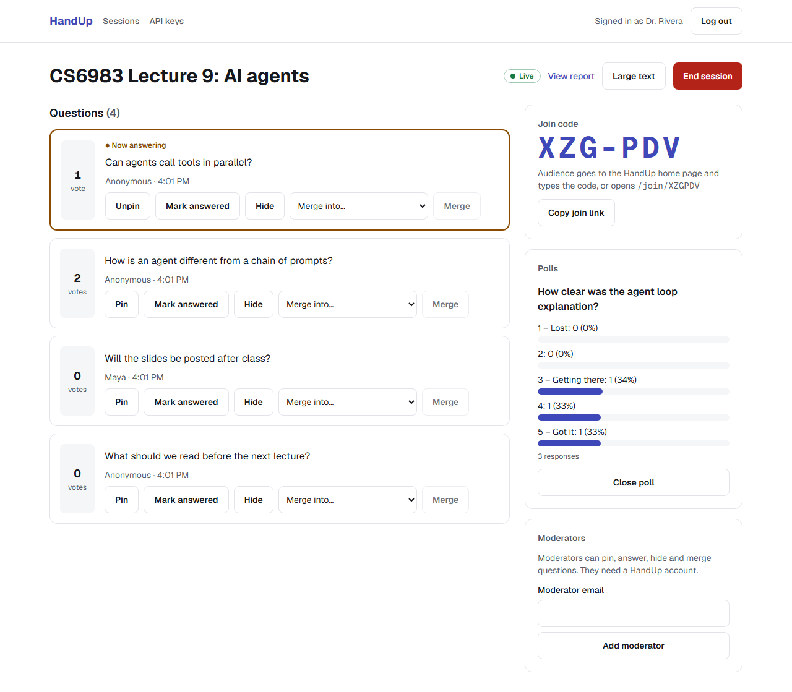
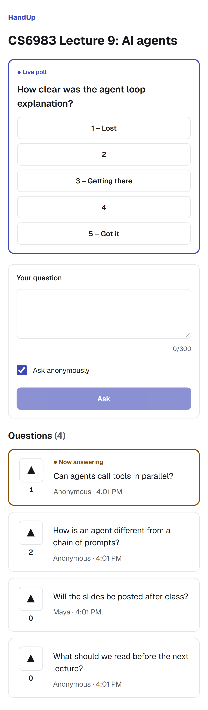
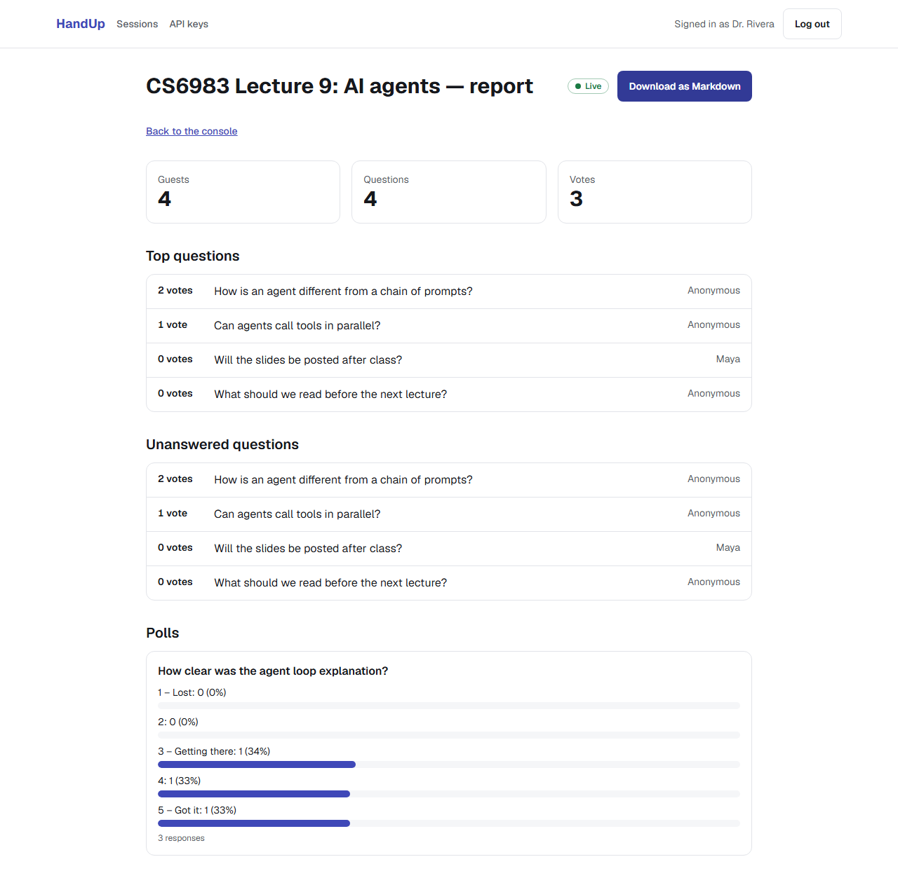

# HandUp

**Live, anonymous Q&A and polls for lectures and talks.** The audience joins from their phones with a
6-character code, asks questions (anonymously by default) and upvotes the ones they share. The board re-ranks
live, the host pins what they are answering, moderators hide and merge, polls show how clear the explanation
was, and a report afterwards shows what the room was confused about.

| | |
| --- | --- |
| **Live app** | https://136-65-108-193.sslip.io · PR previews: https://preview.136-65-108-193.sslip.io |
| **API docs** | `/api-docs` (Swagger UI) · [`public/openapi.json`](public/openapi.json) · [Public API guide](docs/public-api.md) |
| **Demo video** | _link after recording (issue #14)_ |
| **Team** | Ruoyu Wang · Qingyu Cheng — CS6983 Project 2 |

[](https://github.com/geekRoy0126/handup/actions/workflows/ci.yml)
[](https://github.com/geekRoy0126/handup/actions/workflows/security.yml)



<p align="center">
  
  &nbsp;
  
</p>

## Features

| Role | What they can do |
| --- | --- |
| **Host** (account) | Create sessions with a join code · pin / mark answered · hide · merge · launch multiple-choice and confidence polls · end the session · read and download the report · invite moderators · create public API keys · large-text projector mode |
| **Moderator** (account, invited per session) | Pin / mark answered · hide / unhide · merge duplicates · read the report |
| **Guest** (no account) | Join with a code · ask (anonymous by default, 5 per minute) · upvote · answer polls and see live results |
| **Developer** | Read session summaries and poll results through the documented public API with an API key |

- **Real time:** every change reaches all open screens within about a second over Server-Sent Events. Events
  carry only a version number and clients refetch, so hidden questions and anonymous names never leak.
- **Privacy:** anonymous askers' names are never sent to anyone, the host included. Hidden and merged questions
  never reach guests or the public API.
- **Correctness under load:** one vote per guest per question is enforced by the database. Votes and merges lock
  the question rows, so a vote cast while a question is merged is never lost.

## Tech stack

Next.js 16 (App Router + route handlers, one deployable) · React 19 · TypeScript (strict) · Tailwind CSS 4 ·
PostgreSQL 17 · Prisma 7 · JWT with `jose` + bcrypt · Server-Sent Events · zod 4 ·
Vitest + Testing Library · Playwright + axe · GitHub Actions · Semgrep · a Debian VPS (systemd + Caddy HTTPS).

Why one Next.js app instead of the proposal's Express + Socket.IO: see [docs/architecture.md](docs/architecture.md).

## Quick start

```bash
npm install
cp .env.example .env            # set JWT_SECRET (openssl rand -base64 32)
docker compose up -d db         # Postgres on localhost:5432
npx prisma migrate dev
npm run dev                     # http://localhost:3000
```

Full guide, environments and deployment: [docs/setup-deploy.md](docs/setup-deploy.md).

## Tests

| Level | Command | What |
| --- | --- | --- |
| Unit | `npm test` (`npm run test:coverage` for the ≥ 80% domain gate) | Pure domain rules: join codes, ranking, merge votes, poll rounding, report, staff actions, API keys; validation schemas; tokens |
| Integration | `npm run test:int` (needs the Docker database) | Every route handler against real Postgres: auth, 401/403/404/409/422/429, visibility rules, real SSE stream, concurrent vote + merge, OpenAPI coverage |
| E2E | `npm run test:e2e` | Playwright on desktop Chrome and Pixel 7: one flow per user story, real time with **2–3 browser contexts**, axe accessibility checks |

Development is test-first: every feature has a `test(#n)` commit with failing tests before its `feat(#n)`
commit (see the PRs and `git log`).

## CI/CD

| Workflow | Runs on | Stages |
| --- | --- | --- |
| [`ci.yml`](.github/workflows/ci.yml) | every PR and push to `main` | lint + typecheck → unit (coverage) ∥ integration (Postgres) → build → E2E on the production build |
| [`security.yml`](.github/workflows/security.yml) | every PR, `main`, weekly | `npm audit`, gitleaks secret scan, CodeQL, dependency review (CodeQL and dependency review need a public repo) |
| [`deploy.yml`](.github/workflows/deploy.yml) | every PR · every merge to `main` | build on the runner → `prisma migrate deploy` through an SSH tunnel → install on the VPS → Playwright `@smoke` against the deployed URL → GitHub deployment + PR comment with the link. PRs go to the preview slot (fresh database), `main` to production |

## Documentation

| Document | |
| --- | --- |
| [docs/PRD.md](docs/PRD.md) | Problem, roles, product rules, 14 user stories with acceptance criteria and estimates |
| [docs/architecture.md](docs/architecture.md) | System, real-time sequence and CI/CD diagrams; layers; security |
| [docs/database.md](docs/database.md) | ER diagram and schema decisions |
| [docs/public-api.md](docs/public-api.md) · `/api-docs` | Public API guide with curl / JavaScript examples, Swagger UI |
| [docs/setup-deploy.md](docs/setup-deploy.md) | Local setup, environments, deployment, rollback |
| [docs/ui-spec.md](docs/ui-spec.md) | Design tokens, screens, components |
| [docs/sprint-plan.md](docs/sprint-plan.md) | Sprints, issues, working agreement |
| [docs/standups/](docs/standups) · [docs/retros/](docs/retros) | Standups and sprint retrospectives |
| [docs/contribution-log.md](docs/contribution-log.md) | Who did what |
| [AGENTS.md](AGENTS.md) · [docs/ai-usage.md](docs/ai-usage.md) | Shared AI rules file and AI-assisted development log |
| [docs/demo-script.md](docs/demo-script.md) | 10-minute demo outline |

## How we work

GitHub issues from the PRD ([`scripts/setup-github.mjs`](scripts/setup-github.mjs)) → milestones Sprint 1 /
Sprint 2 → branch per issue → failing-test commit → implementation commit → PR with CI and partner review →
merge (never squash, so the TDD history stays visible) → automatic deployment. Details: [AGENTS.md §3](AGENTS.md).
