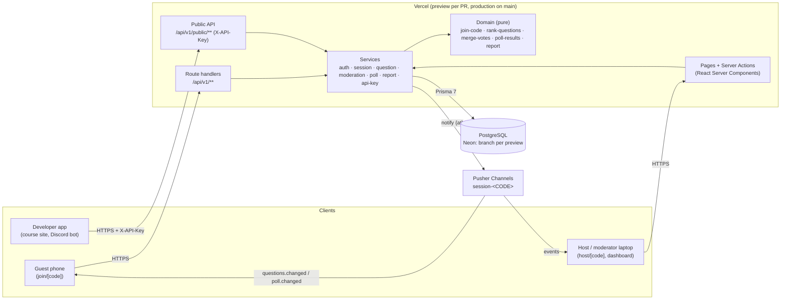
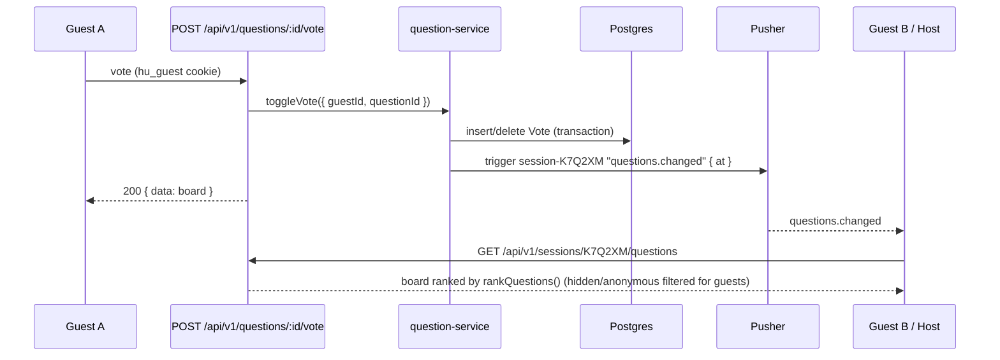
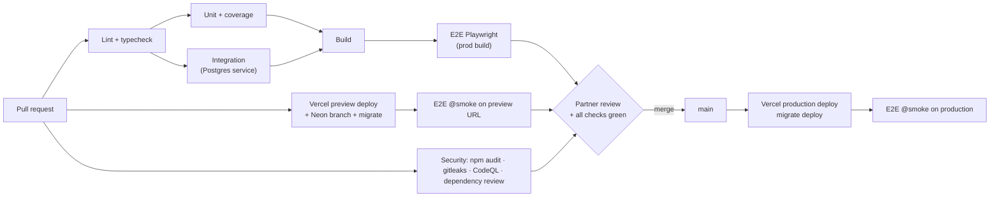

# Architecture

HandUp is one Next.js 16 application: React pages and REST route handlers deploy together to Vercel, data lives
in PostgreSQL (Neon), and Pusher Channels pushes "something changed" events to browsers.

## System context

## Real-time update (upvote example)

## Layers and rules

| Layer | Folder | May import | Tested by |
| --- | --- | --- | --- |
| Pages, components | `src/app`, `src/components` | services (Server Components/Actions only), validation | Component tests, E2E |
| Route handlers | `src/app/api/v1` | `lib/api/http`, validation, services | Integration tests |
| Services | `src/lib/server/services` | `db`, domain, `realtime` | Integration tests (real Postgres) |
| Domain | `src/lib/domain` | nothing with I/O | Unit tests, ≥ 80% coverage |

Why one app instead of Express + Socket.IO (the proposal's first plan): Vercel cannot keep WebSocket connections
open, and a separate API host would need its own preview environments. One Next.js app gives every PR a complete
preview (UI + API + its own Neon database branch) with no extra setup. Pusher handles fan-out; payloads carry
no data, so access rules stay in our services.

## CI/CD pipeline

