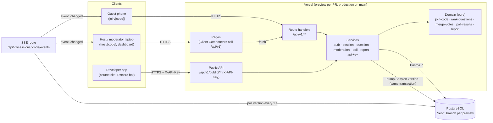
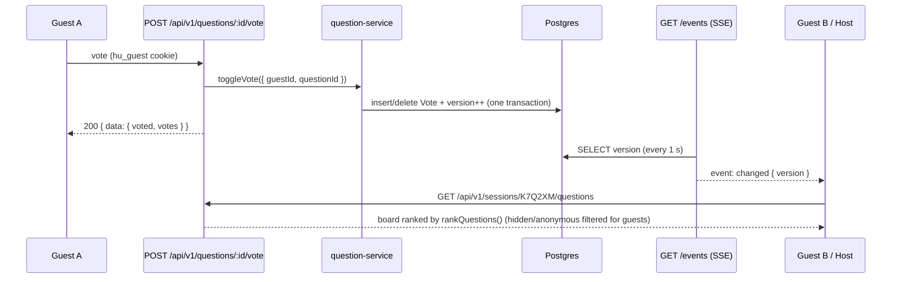
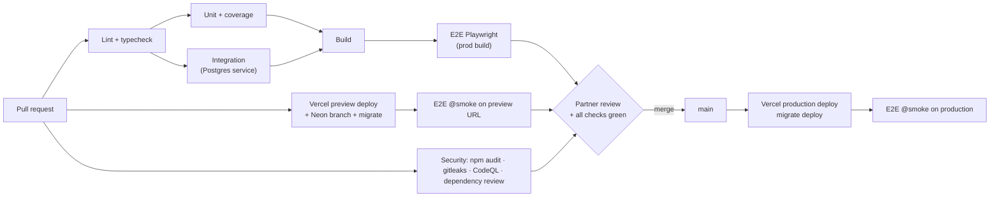

# Architecture

HandUp is one Next.js 16 application: React pages and REST route handlers deploy together to Vercel, data lives
in PostgreSQL (Neon), and a Server-Sent Events stream tells browsers "something changed" so they refetch.

## System context

## Real-time update (upvote example)

## Layers and rules

| Layer | Folder | May import | Tested by |
| --- | --- | --- | --- |
| Pages, components | `src/app`, `src/components` | `lib/client` (fetch /api/v1), pure domain helpers | E2E (+ axe) |
| Route handlers | `src/app/api/v1` | `lib/api/http`, validation, services | Integration tests |
| Services | `src/lib/server/services` | `db`, domain, `realtime` | Integration tests (real Postgres) |
| Domain | `src/lib/domain` | nothing with I/O | Unit tests, ≥ 80% coverage |

Why one app instead of Express + Socket.IO (the proposal's first plan): Vercel cannot keep WebSocket connections
open, and a separate API host would need its own preview environments. One Next.js app gives every PR a complete
preview (UI + API + its own Neon database branch) with no extra setup. Real time uses SSE with a version counter
in Postgres: it works across serverless instances, needs no third-party account, and events carry no data, so
access rules stay in our services.

## CI/CD pipeline

## Security

| Concern | How HandUp handles it |
| --- | --- |
| Authentication | JWT (HS256, `jose`) in httpOnly, SameSite=Lax cookies (`Secure` in production); `Authorization: Bearer` for API clients; `JWT_SECRET` ≥ 32 chars checked at startup |
| Passwords | bcrypt cost 12; one generic login error so accounts cannot be discovered |
| Authorization | Checked in services for every request: `requireHost`, `requireStaff`, `requireGuest`, `requireParticipant`; guest passes are bound to one session; 401 vs 403 distinguished |
| Privacy | `toQuestionView` is the only way questions leave the server: anonymous names removed for everyone, hidden/merged removed for guests and the public API; SSE events carry only a version number |
| Public API | Keys stored as SHA-256 hashes, shown once, revocable; other owners' sessions answer 404 |
| Input | zod on every body and parameter; length limits from the PRD; React escapes all text (no `dangerouslySetInnerHTML`) |
| Abuse | 5 questions per guest per 60 s, counted in the database so it works on serverless |
| Concurrency | Unique keys for votes and poll answers; row locks for vote vs merge; one open poll per session checked in a transaction |
| Supply chain | `npm audit`, gitleaks, CodeQL, dependency review and Dependabot in CI |
