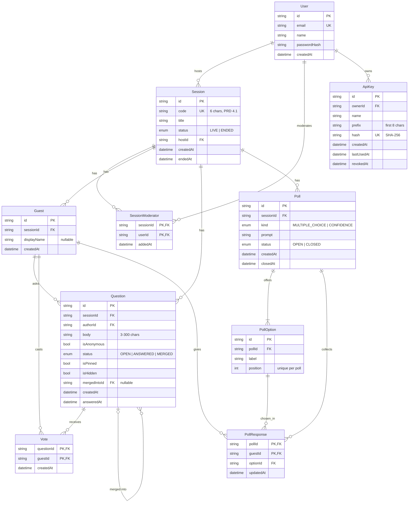

# Database schema

Source of truth: `prisma/schema.prisma`. Product rules that the schema supports: `docs/PRD.md` §4.

## Design decisions

| Decision | Why |
| --- | --- |
| Composite primary keys on `Vote (questionId, guestId)` and `PollResponse (pollId, guestId)` | The database itself guarantees one vote per guest per question and one answer per poll, even under concurrent requests |
| Guests are rows, not users | Audience members need identity (one vote, rate limit, "your question") without an account or email |
| Host/moderator are relationships, not a global role column | The same person can host one session and moderate another |
| `mergedIntoId` self-relation + `MERGED` status | Merges keep history for the report instead of deleting rows |
| Only the hash of an API key is stored | A database leak does not leak usable keys |
| Indexes on `(sessionId, status)` and `(authorId, createdAt)` | Board queries and the 60-second rate-limit count |
| `onDelete: Cascade` from Session | Deleting a session removes everything that belongs to it |
